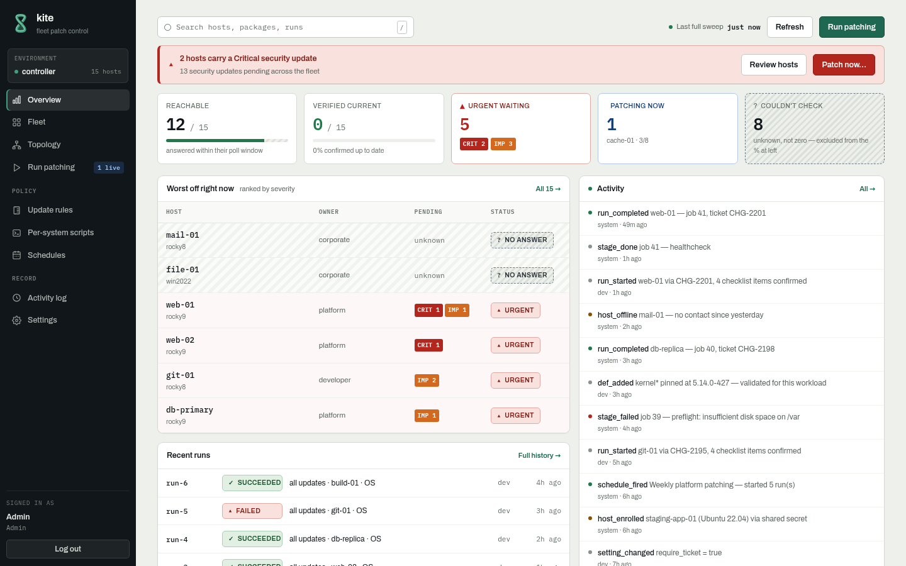
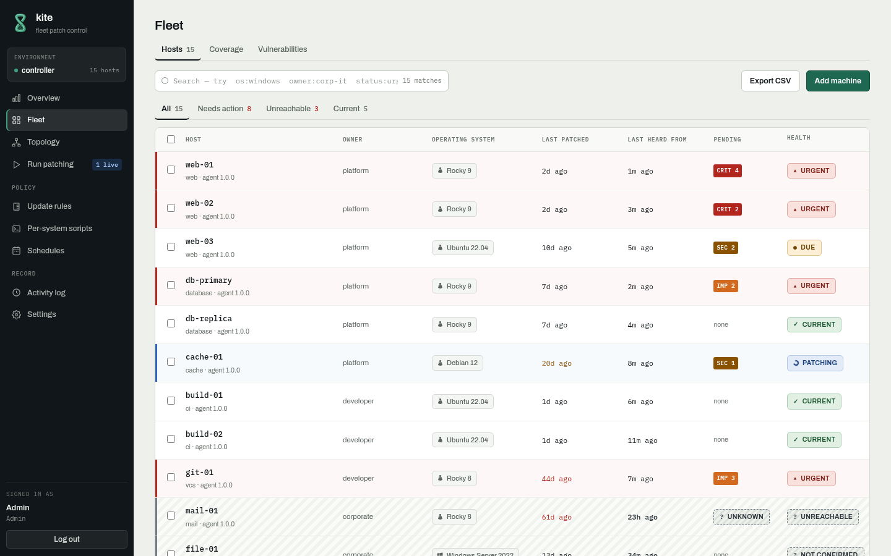
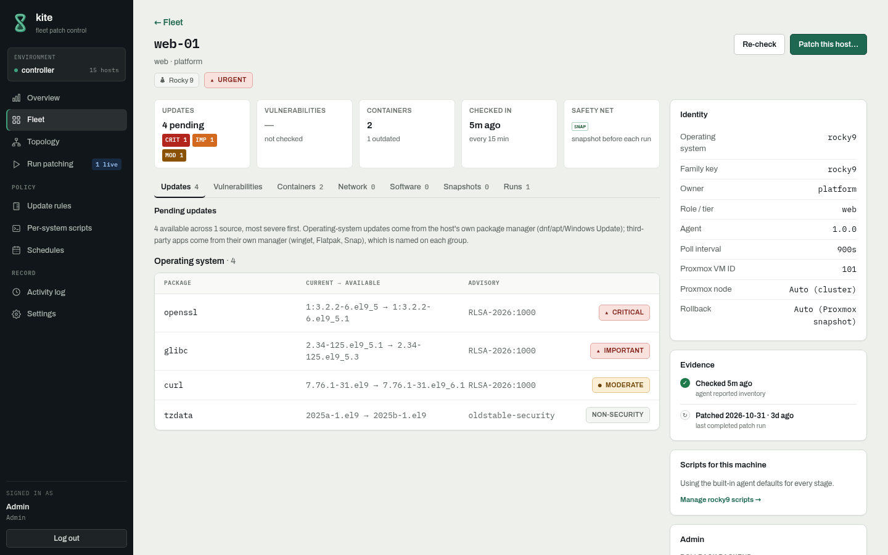
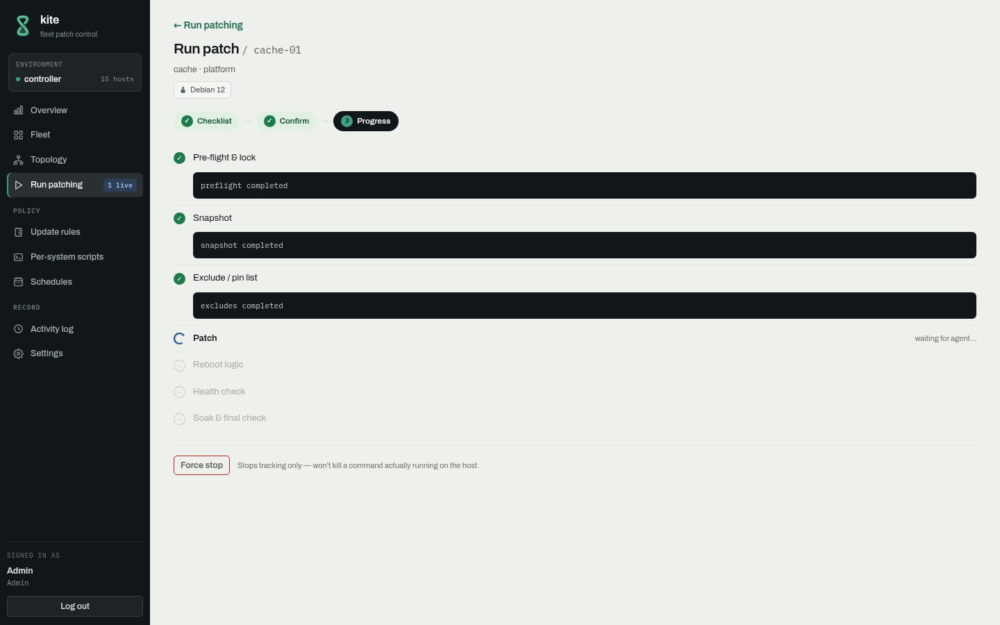
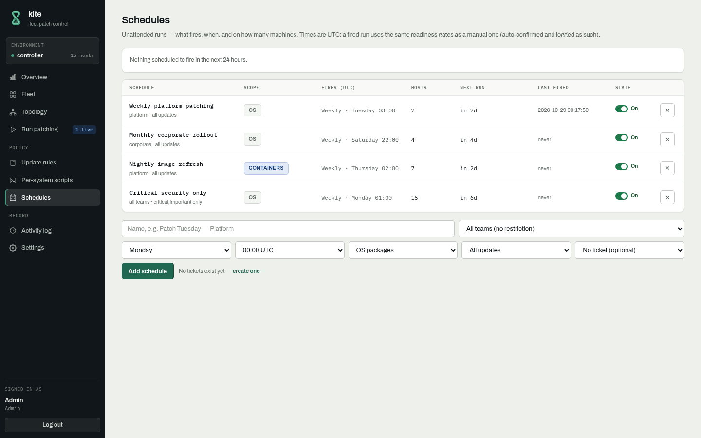
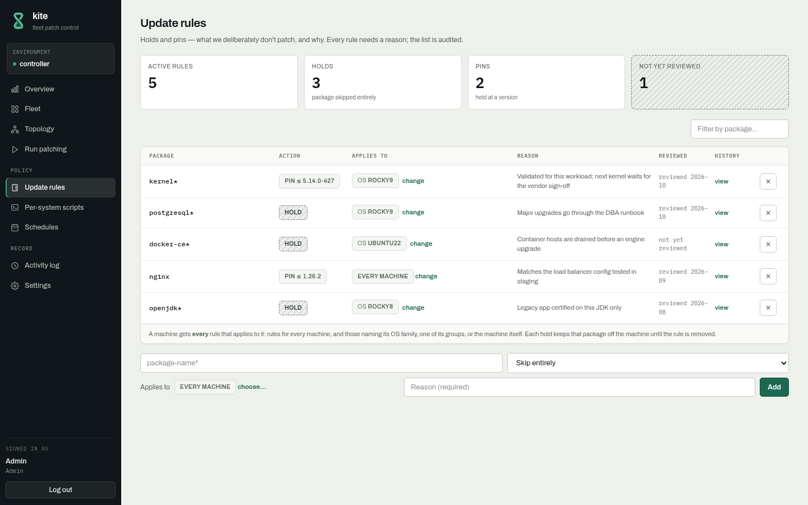
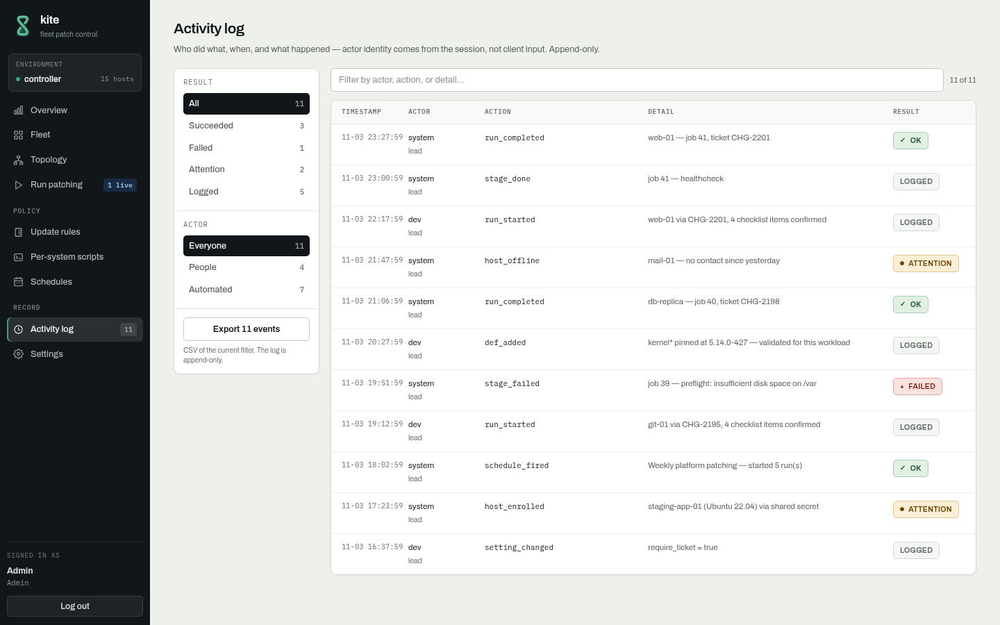
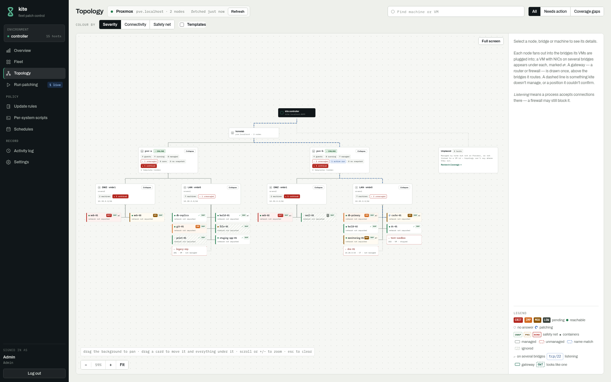

<p align="center"></p>

<h1 align="center">kite</h1>

<p align="center"><em>KEE-teh · to see, to find</em></p>

<p align="center"><b>Patch your Linux and Windows fleet from one place, with a snapshot before every change.</b></p>

<p align="center">
  <a href="https://github.com/SiraBet/kite/actions/workflows/tests.yml"></a>
  <a href="LICENSE"></a>
  
</p>

<p align="center"></p>

## Features

◆ **Snapshot first, always.** Every run takes a Proxmox snapshot or a dnf history point before touching a package, and gives you one-click rollback.

◆ **No SSH, no inbound ports.** Agents poll the controller and do the work locally. There are no keys to hand out.

◆ **Linux and Windows.** RHEL, Rocky, Alma, Oracle, Debian and Ubuntu, plus Windows Server through Windows Update.

◆ **Risk at a glance.** See what's pending on every machine, ranked by severity, and which machines didn't answer.

◆ **Schedules.** Patch Tuesday, nightly security-only runs, or a run right now across one machine or fifty.

◆ **Containers too.** Compose services are pulled and recreated safely. Anything else is reported, never touched.

◆ **Proxmox topology.** Nodes, bridges and VMs on one map, including the ones kite doesn't manage yet.

◆ **Per-OS scripts.** Override pre-flight, excludes or patch for any distro or group. An AI assistant can write them for you.

◆ **Full audit trail.** Who ran what, when, and why.

◆ **Plays well with others.** Slack, email and webhook notifications, LDAP sign-in, and a read-only MCP server for any MCP client.

◆ **Change control when you want it.** Tickets and approvals are there, and off by default.

## Why kite

◆ **More than a patch playbook.** Rollback, an audit trail and a console come built in, with no need to write them yourself.

◆ **Lighter than Foreman or Uyuni.** One controller and one SQLite file. There's no Pulp, Candlepin or Salt stack to keep running.

## Screenshots

<table>
<tr>
<td></td>
<td></td>
</tr>
<tr>
<td></td>
<td></td>
</tr>
<tr>
<td></td>
<td></td>
</tr>
</table>

<p align="center"></p>

## Quick start

You need [Docker](https://docs.docker.com/engine/install/) with the Compose plugin.

```bash
git clone https://github.com/SiraBet/kite.git
cd kite/controller && docker compose up -d
docker compose logs controller | grep -A4 "ADMIN LOGIN"
```

Open `https://localhost`, sign in, and enrol your first machine from **Fleet → Enroll**. Copy the one-line command onto a Linux host, or download the installer for Windows.

Prefer no Docker? See [INSTALL.md](controller/INSTALL.md).
To upgrade, run `git pull && docker compose up -d --build`.

## Documentation

- [Controller](controller/README.md): configuration, rollback backends, Proxmox, the API
- [Linux agent](agent-linux/README.md) · [Windows agent](agent-windows/README.md)
- [Per-OS script templates](controller/examples/os-scripts/) · [AI skill](ai/skills/kite-stage-script/)
- [Roadmap](controller/ROADMAP.md) · [Changelog](CHANGELOG.md)

## Contributing

Issues and pull requests are welcome. See [CONTRIBUTING.md](CONTRIBUTING.md). Report security issues through [SECURITY.md](SECURITY.md).

## License

[Apache 2.0](LICENSE)
